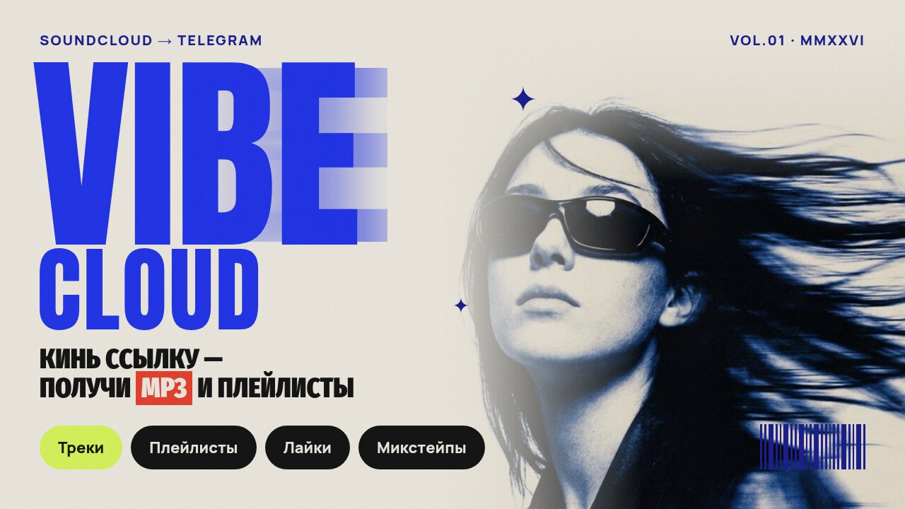

# VibeCloud — SoundCloud → Telegram

Telegram-бот и Mini App для переноса музыки из SoundCloud: отдельные треки, плейлисты, альбомы, лайки и целые профили.
Треки приходят MP3-файлами с тегами и обложкой, живут в медиатеке с плеером и офлайн-кэшем Telegram, ими легко делиться с друзьями.



## Как переносить (самый быстрый путь)

| Способ | Что делать | Что получится |
|---|---|---|
| **Поделиться из SoundCloud** | В приложении SoundCloud → «Поделиться» → Telegram → чат с ботом | Трек — сразу MP3. Плейлист — карточка с живым прогрессом и кнопками «Скачать все / Открыть / Следить» |
| **Любое сообщение со ссылкой** | Кинуть боту одну или несколько ссылок (в т.ч. `on.soundcloud.com/…`), можно пересланным сообщением | Бот сам распознает трек / плейлист / альбом / лайки / профиль |
| **Профиль целиком** | Ссылка на профиль `soundcloud.com/user` | Выбор: все лайки, все треки артиста или все плейлисты разом |
| **Mini App** | Кнопка меню → вставить ссылку или кнопка «Вставить» | Треки «прилетают» в медиатеку вживую, MP3 докачиваются в фоне |
| **Инлайн в любом чате** | `@VibeCloudBot название` или ссылка | Трек уходит другу аудиофайлом прямо в его чат |

Плейлист на 500 треков не блокирует ничего: список появляется сразу, MP3 готовятся по запросу (отправка, «Скачать все», шаринг). Повторный трек не качается второй раз — бот переиспользует `file_id` Telegram.

## Экономный режим (LITE_MODE, включён по умолчанию)

Сервер почти не гоняет трафик и не хранит музыку — всё, что можно, идёт напрямую из Telegram и SoundCloud:

| Что | Откуда идут байты | Нагрузка на сервер |
|---|---|---|
| Трек/плейлист в чат, пересылка, инлайн, микстейпы | Telegram по `file_id` | ноль (после первой загрузки трека) |
| Плеер в Mini App | CDN SoundCloud напрямую на телефон (HLS AAC 160, hls.js с jsDelivr) | только короткий запрос подписанной ссылки |
| «Скачать» в Mini App | MP3 приходит в чат с ботом из Telegram | ноль, если трек уже в Telegram |
| Обложки, waveform | CDN SoundCloud | ноль / пара КБ |
| Первая загрузка нового трека | SoundCloud → сервер (yt-dlp, MP3 192 kbps) → Telegram | ~5–7 МБ на трек, **один раз на всех пользователей** |

- Локальный MP3 удаляется через несколько минут после загрузки в Telegram; если файл снова понадобится серверу, он берётся обратно из Telegram (`getFile`, до 20 МБ), а не качается заново.
- Ничего не качается заранее (`PREFETCH_PER_IMPORT=0`), кэш на диске ограничен 1 ГБ, 2 потока загрузки.
- Если прямой поток недоступен (старый WebView, сеть блокирует CDN) — плеер сам переключается на поток через сервер.
- На диске остаётся только база SQLite (несколько МБ): медиатеки, плейлисты, микстейпы и связки «трек → `file_id`».

`LITE_MODE=0` возвращает классический режим: плеер и скачивание через сервер, заранее качаются первые 25 треков плейлиста, кэш 10 ГБ.

## Возможности

- **Медиатека и плеер** в Mini App: постерный плеер с гигантской типографикой, точечная волна (waveform SoundCloud), свайпы, шаффл/повтор, Media Session (управление с экрана блокировки), подсветка цвета по обложке.
- **«В пути» (LIVE)**: прогресс переноса в реальном времени (SSE) — треки появляются по одному, точки заполняются по мере скачивания.
- **Скачать** в чат аудиофайлом прямо из Telegram (в классическом режиме — ещё и на устройство через `Telegram.WebApp.downloadFile`); «Скачать все» для плейлиста — альбомами по 10.
- **Поделиться с другом**: `shareMessage` (подготовленное инлайн-сообщение с аудио) или инлайн-режим; по ссылке друг открывает трек и сохраняет себе.
- **Микстейпы**: собрать подборку, выбрать стиль постера (Кобальт / Бетон / Дым / Неон), добавить записку и отправить. Друг открывает постер и забирает все треки в один тап.
- **Слежение за плейлистами** 🔔: новые треки сами добавляются, бот присылает уведомление.
- **Поиск** по медиатеке и по SoundCloud, добавление в один тап.
- **Статистика**: перенесено треков, минуты музыки, дни подряд, активность недели.
- Треки с DRM / Go+ / гео-блоком помечаются 🔒 и не ломают перенос.

## Быстрый старт

1. **Бот.** В [@BotFather](https://t.me/BotFather): `/newbot` → токен. Затем:
   - `/setinline` → включить инлайн (плейсхолдер, например «название трека или ссылка»);
   - `/setinlinefeedback` → `Enabled` (нужно, чтобы инлайн-результат превращался в аудио);
   - `/newapp` → выбрать бота, URL = ваш `PUBLIC_URL`, short name = `app` (→ `WEBAPP_SHORT_NAME`).
   Кнопку меню и команды бот настроит сам при запуске.
2. **Канал-хранилище (рекомендуется).** Создайте приватный канал, добавьте бота админом, укажите его id в `STORAGE_CHAT_ID`. Туда заливаются файлы для инлайна и шаринга — без него бот присылает и удаляет служебное сообщение.
3. **Конфиг.** `cp .env.example .env` и заполните `BOT_TOKEN`, `PUBLIC_URL`.
4. **Запуск в Docker:**
   ```bash
   docker compose up -d --build
   ```
   Сервер слушает `:8080`. Mini App требует HTTPS — поставьте перед ним Caddy (пример `Caddyfile` в репозитории, сертификат выпустится сам) или nginx.
5. **Без Docker:** Python 3.11+, ffmpeg в PATH.
   ```bash
   pip install -r requirements.txt
   python -m app.main
   ```

### nginx

```nginx
location / {
    proxy_pass http://127.0.0.1:8080;
    proxy_http_version 1.1;
    proxy_set_header Host $host;
    proxy_buffering off;          # SSE /api/events и стриминг аудио
    proxy_read_timeout 1h;
}
```

### Большие файлы

Облачный Bot API принимает файлы до 50 МБ — бот подбирает битрейт MP3, чтобы уложиться (длинные миксы → ниже битрейт). Для полного качества и файлов до 2 ГБ поднимите свой [Bot API server](https://github.com/tdlib/telegram-bot-api) (раскомментируйте `bot-api` в `docker-compose.yml`) и задайте `TELEGRAM_API_URL`.

## Бесплатный хостинг на Render (без карты)

1. Загрузите проект в репозиторий GitHub и на render.com: **New → Blueprint** → репозиторий (подхватится `render.yaml`).
2. Введите `BOT_TOKEN` и `STORAGE_CHAT_ID`. `PUBLIC_URL` не нужен — берётся из `RENDER_EXTERNAL_URL`.
3. Сервис не засыпает сам: на Render он раз в 10 минут стучится в свой адрес `/api/health` (`KEEPALIVE_MIN=10`, `0` — выключить). Работа 24/7 занимает ~744 из 750 бесплатных часов в месяц, поэтому держите в этом workspace Render только VibeCloud. Для подстраховки можно добавить такой же запрос на cron-job.org.
4. Диск бесплатного Render стирается при перезапуске. Опция `DB_BACKUP_MIN=10` (на Render включена по умолчанию) сохраняет сжатую копию базы (медиатеки, плейлисты, микстейпы, связки трек → `file_id`) в ваш приватный канал `STORAGE_CHAT_ID` и закрепляет её; при старте бот восстанавливает базу из закреплённой копии. Боту в канале нужны права публиковать, редактировать и удалять сообщения.

## Демо без сервера

Откройте `webapp/index.html?demo` в браузере (или через любой статический сервер) — Mini App запустится с вымышленной медиатекой и симуляцией переноса. Вне Telegram демо включается автоматически.

## Устройство

```
app/
  main.py            запуск: бот (polling) + веб-сервер + фоновая синхронизация плейлистов
  soundcloud.py      клиент api-v2: resolve ссылок, пагинация плейлистов/лайков, поиск, waveform
  importer.py        перенос: превью, NeedChoice для профилей, апсерт плейлистов, live-события
  downloader.py      очередь с приоритетами + экспресс-полоса, yt-dlp → MP3 (CBR ≤192 под лимит), ID3 + обложка, LRU-кэш, возврат файлов из Telegram
  db.py              SQLite (aiosqlite): треки, медиатеки, плейлисты, микстейпы, прослушивания, статистика
  bot/               хендлеры, инлайн-режим, отправка с кэшем file_id и живым прогрессом
  web/api.py         REST + SSE, подписанные ссылки на стрим (Range) и скачивание, авторизация по initData
webapp/              Mini App без сборки: index.html, css/app.css, js/app.js, js/demo.js, js/vendor/hls.light.min.js (запасная копия), шрифты, картинки
tests/smoke_bot.py   сквозной тест сценариев бота на фейковой сессии Telegram
```

Ключевые эндпоинты: `GET /api/bootstrap`, `GET /api/events` (SSE), `POST /api/import`, `POST /api/import/inspect`, `GET /api/search`, `POST /api/track/{id}/send|share|like|add|prefetch`, `GET /api/track/{id}/direct` (подписанная ссылка CDN SoundCloud для плеера), `GET /api/stream/{id}` (запасной поток, подписанный, Range), `GET /api/playlist/{id}`, `POST /api/playlist/{id}/send|watch|sync`, `POST /api/mixtapes`, `POST /api/mixtape/{code}/claim|share`.

## Ограничения и честное использование

- Только публично доступные треки. Go+/DRM-контент и треки, закрытые правообладателем, не скачиваются — их видно в медиатеке с замком.
- Используйте для личного прослушивания и уважайте артистов: ссылка «SoundCloud ↗» есть у каждого трека, лайкайте и поддерживайте авторов там.
- Неофициальный API SoundCloud может меняться; `client_id` подхватывается автоматически, `yt-dlp` стоит периодически обновлять (`pip install -U yt-dlp`).
